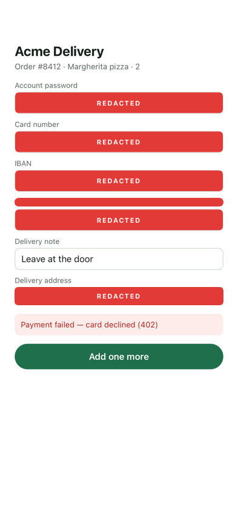
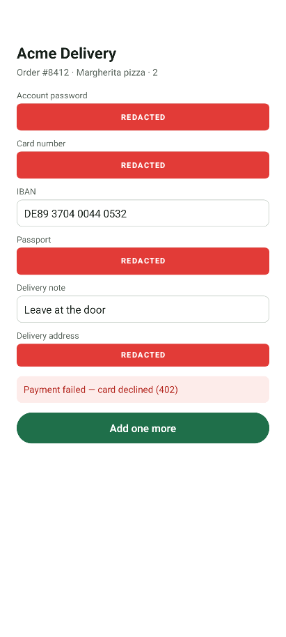

# Snaply Agent — React Native example

A runnable React Native app with the Snaply Agent SDKs inside. There is no React Native package
yet: the app uses the **native iOS and Android SDKs as they are**, started from the app's two native
entry points. A React Native screen is made of real native views, so the SDKs capture it and hide
fields in it like in any other app.

The whole integration is two functions:

- iOS — [`ios/SnaplyExample/AppDelegate.swift`](ios/SnaplyExample/AppDelegate.swift)
- Android — [`android/app/src/main/java/com/example/snaplyexample/reactnative/MainActivity.kt`](android/app/src/main/java/com/example/snaplyexample/reactnative/MainActivity.kt)

[`App.tsx`](App.tsx) is the screen — a fake food-delivery order — and shows how a React Native
field is hidden from a capture.

## Run it

1. `npm install`, and for iOS `cd ios && pod install`.
2. Replace the placeholder key in both native files:

   ```
   snap_live_REPLACE_WITH_YOUR_KEY
   ```

   Get yours from the Snaply console → **Products → your product → API key**. An iOS product and
   an Android product each have their own key.

3. Add the app's identifier to each product's allowed list, or registration is refused. This
   example uses `com.example.snaplyexample.reactnative` on both platforms.
4. `npx react-native run-ios` or `npx react-native run-android`.
5. Open the console, find the device, and request a screenshot. The consent prompt appears on the
   phone; nothing is captured until it is allowed.

## Adding the SDK to your own React Native app

**iOS.** In Xcode, *File → Add Package Dependencies…* and add
`https://github.com/Mobile-LLC/SnaplyAgent-SDK-iOS` to the app target. The Swift package sits
beside CocoaPods without conflict. Then, in `AppDelegate.swift`:

```swift
import SnaplyAgent

Snaply.configure(key: "snap_live_…")
```

iOS 15 is the SDK's floor; the React Native template's is 15.1.

**Android.** One dependency in `android/app/build.gradle`, from Maven Central:

```gradle
implementation("com.snaplyagent:agent:2.38.0")
```

Then, in `MainActivity.onCreate`:

```kotlin
Snaply.init(context = this, key = "snap_live_…")
```

`minSdk` 24 and Java 17 are the SDK's floors, and the template's.

## Redaction — read this before you ship

**The SDK hides password fields on its own and nothing else.** Everything else on screen is captured
as it is. In React Native:

| What you write | Hidden in the capture |
|---|---|
| `<TextInput secureTextEntry />` | Yes, on its own — it is the native secure field |
| `testID="snaply-redact-anything"` on any component | Yes — a `testID` containing `snaply-redact` is the SDK's mark |
| A dashboard rule by **text** (Products → Hidden fields) | Yes — it matches `placeholder` and `accessibilityLabel` |
| A dashboard rule by **identifier**, naming a `testID` | **iOS yes. Android not yet** — see below |

The box is painted **on the device, before the image is encoded**, so the underlying pixels never
leave the phone.

Two things to know:

- **Android, identifier rules.** React Native puts a `testID` in the view's tag, not in an Android
  resource id, and the SDK's identifier rule reads the resource id. Until the SDK reads the tag
  too, hide such a field with the mark (`testID="snaply-redact-…"`) or with a text rule.
- **A text rule hides every view whose label contains the text.** On iOS a `<Text>` is its own
  accessibility label, so a rule containing `passport` also hides a caption that reads
  "Passport".

## Remote control

When the person allows it during a live session, the agent can tap and type for them.

- **Android**: taps and typing work with nothing added.
- **iOS**: typing into a `TextInput` works with nothing added. A tap reaches a control through
  accessibility activation, and React Native answers that only when `onAccessibilityTap` is set —
  so a pressable the agent should be able to tap carries it next to `onPress`:

  ```tsx
  <Pressable onPress={addItem} onAccessibilityTap={addItem} accessibilityRole="button">
  ```

## What was measured

On 2026-11-10, with this app as committed: React Native 0.88.1 (new architecture), the iOS SDK
2.47.0 on an iOS 18.6 simulator, the Android SDK 2.38.0 on an API 34 emulator, against a local
Snaply backend.

| | iOS | Android |
|---|---|---|
| Registers and comes online | ✓ | ✓ |
| Screenshot after consent, screen content correct | ✓ | ✓ |
| Password field hidden on its own | ✓ | ✓ |
| `testID` mark hidden (input and text) | ✓ | ✓ |
| Dashboard rule by identifier (`testID`) | ✓ | ✗ |
| Dashboard rule by text | ✓ | ✓ |
| Live view | ✓ | ✓ |
| Remote control — tap a pressable | ✓ with `onAccessibilityTap`, ✗ without | ✓ |
| Remote control — type into a field | ✓ | ✓ |

Not measured: Expo (a managed app has no native folders in the repo; the two init calls would go
through a config plugin), and a physical device.

What the agent received — the same screen on iOS and on Android (the IBAN is the identifier rule
that does not match on Android yet):

| iOS | Android |
|---|---|
|  |  |

## What is not here yet

There is no JavaScript API. `Snaply.identify(…)` after sign-in, `Snaply.reset()` on sign-out and
`Snaply.showSupportCode()` are native calls; from JavaScript they need a native module. This
example passes a user at start instead.

## Pointing a debug build at another backend

Debug builds read an override at launch, so the same app can talk to a backend on your own
machine:

- iOS — the launch environment: `SNAPLY_KEY`, `SNAPLY_HOST` (an Xcode scheme, or
  `SIMCTL_CHILD_SNAPLY_HOST=http://localhost:5100 xcrun simctl launch …`).
- Android — launch intent extras: `--es snaplyKey … --es snaplyHost http://10.0.2.2:5100`.

Plain `http` is accepted for the machine's own loopback only.

## Docs

<https://snaplyagent.com/docs>
